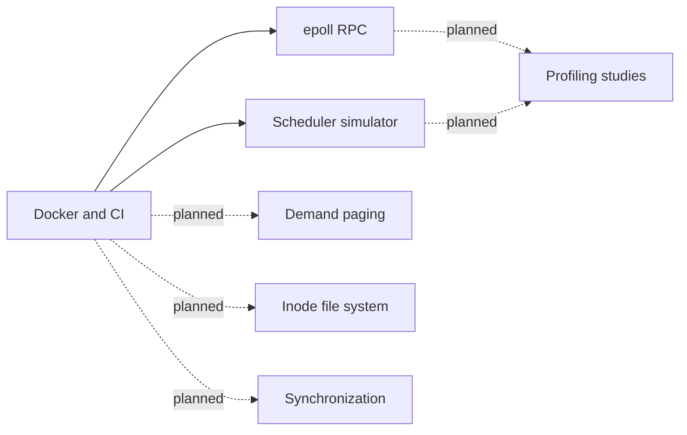

# os-subsystems

Original operating-system experiments in C++20 for Linux.

This is a personal project started in 2026. It is separate from course labs.
No course lab code is copied or adapted.

## Component map



## Status

| Component | Status | Results |
| --- | --- | --- |
| Docker and continuous integration (CI) | Initial build in progress | Not measured |
| Remote procedure call (RPC) service | Planned | Not measured |
| Scheduler simulator | Planned | Not measured |
| Virtual memory, file system, synchronization, profiling | Planned | Not measured |

## Build and test

Prerequisites: Docker with a Linux engine, Make, and an internet connection for
the first build. Use a Linux ARM64 or AMD64 host. On macOS, use Docker Desktop.

1. Build the development image.

   ```sh
   make dev
   ```

2. Run all tests and sanitizer builds.

   ```sh
   make test
   ```

3. Build the runtime image.

   ```sh
   make image
   docker run --rm os-subsystems:local
   ```

AddressSanitizer (ASan), UndefinedBehaviorSanitizer (UBSan), and ThreadSanitizer
(TSan) use separate builds. A failed test stops the command. The test container
uses an unrestricted seccomp profile so TSan can set its address layout. The
runtime container uses Docker's default profile and a non-root user.

The base image has a fixed digest. Package sources use a dated Debian snapshot.
See [the Dockerfile](docker/Dockerfile) for these values. The runtime image holds
the installed programs and their runtime libraries. Build tools stay in the
development image.

The CI file is ready for GitHub Actions. A local test result does not show that
GitHub CI has passed.

## Design and evidence

See the [implementation plan](docs/implementation-plan.md) for scope, measurement
rules, and references. Results will include commands, sample counts, and hardware.
