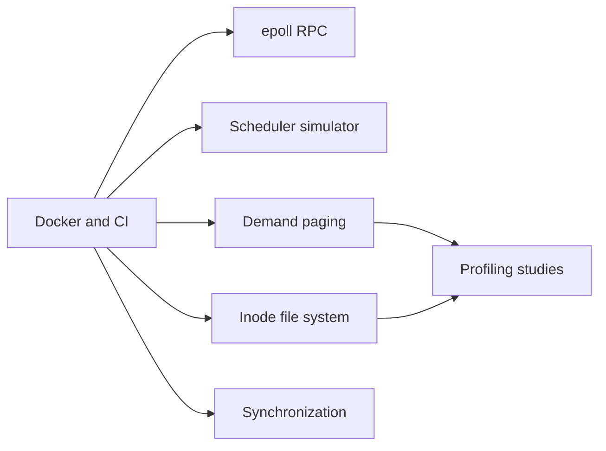

# os-subsystems

Original operating-system experiments in C++20 for Linux.

This is a personal project started in 2026. It is separate from course labs.
No course lab code is copied or adapted.

## Component map



## Status

| Component | Status | Results |
| --- | --- | --- |
| Docker and continuous integration (CI) | Local build and tests pass; GitHub CI has not run | Image and binary measurements below |
| Remote procedure call (RPC) service | Implemented and tested | Saved loopback measurements below |
| Scheduler simulator | Implemented and tested | Saved simulation results below |
| Demand paging | Implemented and tested | Synthetic and captured-trace results below |
| Inode file system | Implemented and tested, including a FUSE mount | Structural checks and crash results below |
| Synchronization primitives | Implemented and tested | Contention results below; race and deadlock reproductions remain open |
| Profiling case studies | Two changes measured | VM locality and file-system bitmap results below |

## Measured results

Measurements were made on 2026-10-13. The host was an Apple M4 with 16 GiB RAM.
Docker Desktop used a Linux ARM64 virtual machine (VM) with 10 logical CPUs.
Benchmark containers had a 4-CPU limit and a 4 GiB memory limit. Other workloads
shared the VM. Compiler: Clang 19.1.7. Build: Release, without sanitizers.

### RPC

Each row shows the range across three runs. Each run used 500 measured requests
and 50 warmup requests per connection. The payload was 64 bytes. All connections
were open before warmup. Pipeline depth is the maximum number of outstanding
requests per connection. Latency includes time in the client's send queue.

| Connections | Pipeline depth | Measured samples, all runs | p50 (ms) | p95 (ms) | p99 (ms) | Requests/s |
| --- | --- | --- | --- | --- | --- | --- |
| 64 | 1 | 96,000 | 0.201–0.338 | 0.574–2.048 | 1.025–6.752 | 99,759–235,514 |
| 256 | 1 | 384,000 | 1.028–1.996 | 2.672–8.163 | 4.425–20.918 | 84,952–200,313 |
| 1,024 | 1 | 1,536,000 | 4.242–6.989 | 10.853–18.692 | 16.072–40.396 | 116,592–198,674 |
| 64 | 4 | 96,000 | 0.483–0.832 | 1.111–2.008 | 2.142–4.255 | 264,746–401,488 |
| 256 | 4 | 384,000 | 1.910–3.989 | 2.934–8.750 | 4.771–12.277 | 235,956–515,185 |
| 1,024 | 4 | 1,536,000 | 10.364–18.416 | 21.342–40.057 | 30.542–67.942 | 198,413–337,957 |

All 4,032,000 measured requests passed ID and payload checks. No run reported an
error. These runs do not support a median below 1 ms at 256 connections. This is
a loopback test with a closed request loop. It does not establish latency on a
remote network or under a fixed external arrival rate.

Source: [RPC results and raw samples](results/20261013T195428Z-rpc/rpc.json).
See the [environment record](results/20261013T195428Z-rpc/environment.json) and
[protocol and measurement rules](docs/rpc.md).

### Schedulers

These values use simulated time. They are not wall-clock speed measurements.
Each policy ran once on each deterministic workload. The mixed workload has
12 processes. Every process completed.

| Policy | Mean response (simulated ms) | Mean turnaround (simulated ms) | Processes with a ready wait ≥50 ms |
| --- | --- | --- | --- |
| FIFO | 253.333 | 343.667 | 11 |
| Round-robin | 7.000 | 324.667 | 0 |
| MLFQ | 3.167 | 257.583 | 0 |
| CFS | 1.583 | 210.458 | 0 |

The fairness tests use a 500 ms observation window. All processes stay runnable.
Jain's index uses CPU service divided by process weight. Its maximum is 1.

| Policy | Equal weights, 8 processes | Different nice values, 4 processes |
| --- | --- | --- |
| FIFO | 0.125000 | 0.250000 |
| Round-robin | 0.999808 | 0.483770 |
| MLFQ | 0.999041 | 0.482439 |
| CFS | 0.999936 | 0.999975 |

Source: [scheduler results, inputs, and timelines](results/20261013T221310Z-sched/scheduler.json).
See [policy rules and metric definitions](docs/schedulers.md). CFS models the
historical vruntime design. It does not reproduce the current Linux scheduler.

### Demand paging

Each synthetic case has 65,536 accesses and a 16-entry TLB. All three policies
produced 64 faults on the looping trace when the 64-page working set fit in
64 frames. FIFO's 12-access anomaly trace produced 9 faults with 3 frames and
10 faults with 4 frames. Source: [synthetic paging results](results/20261013T223244Z-vm/vm.json).

The captured trace has 657,610 modeled page touches across 321 pages. It includes
startup and shutdown of the original trace program. Each policy ran once per
frame count. The table shows fault counts and TLB hit rates.

| Frames | FIFO faults | Clock faults | Aging faults | FIFO TLB hits | Clock TLB hits | Aging TLB hits |
| --- | --- | --- | --- | --- | --- | --- |
| 16 | 57,967 | 50,591 | 44,512 | 91.185% | 92.307% | 93.231% |
| 64 | 2,087 | 1,401 | 30,826 | 92.452% | 92.462% | 92.816% |
| 128 | 672 | 509 | 20,262 | 92.460% | 92.462% | 92.446% |

Aging is an LRU approximation with a fixed sampling period. It did not give the
fewest faults at every memory size. Source: [captured-trace results](results/20261013T223954Z-lackey/vm.json).
An [independent reference check](results/validation/vm-reference-check.log) passed
all 38 synthetic and captured-trace cases. See [VM design and trace limits](docs/virtual-memory.md).

### File system

The file system uses an original disk format. It has inode and block bitmaps,
directories, hard links, sparse files, and direct and indirect block pointers.
The FUSE interface mounts an image on Linux.

| Check | Observed result |
| --- | --- |
| File data compared with a separate byte model | 500 operations passed |
| CLI file transfer across double-indirect blocks | 5,120,000 bytes matched |
| Concurrent FUSE file transfers | 48 round trips of 16,384 bytes, 4 workers |
| Structure after the mounted workload | 53 allocated and reachable inodes; 197 referenced data blocks; no findings |
| Six modified images | The checker detected all six corruption cases |
| Writer killed after an allocation bitmap write | The checker found allocated blocks without references |
| Writer killed after a data block overwrite | 4,096 new bytes and 4,096 old bytes; the structure check passed |

The file system has no journal. A clean structure check does not prove that an
interrupted data write was atomic. These tests used SIGKILL at controlled points.
They did not simulate power loss. Source: [saved file-system cases](results/20261013T230437Z-fs/process-cases.json)
and [mounted results](results/20261013T230437Z-fs/fuse-cases.json).
See [the format, limits, and commands](docs/filesystem-design.md).

### Synchronization

The table gives median throughput across three runs, in millions of operations
per second. One container operation is one push or pop. One mutex operation is
one protected increment. Compare implementations within each pair. Containers
have 8,192 slots. Each worker alternates a push and a pop.

| Implementation | 1 thread | 2 threads | 4 threads | 8 threads |
| --- | --- | --- | --- | --- |
| `std::mutex` counter | 218.150 | 47.478 | 43.205 | 36.625 |
| Futex mutex counter | 360.782 | 89.982 | 82.339 | 52.154 |
| Stack with futex mutex | 227.251 | 42.847 | 43.210 | 38.351 |
| Tagged Treiber stack | 175.954 | 37.021 | 10.509 | 6.759 |
| Queue with futex mutex | 206.463 | 30.503 | 36.846 | 36.994 |
| Michael–Scott queue with hazard pointers | 37.067 | 14.678 | 6.339 | 3.034 |

Each case uses a saved calibration to select its iteration count. Measured runs
lasted 0.009842–0.651309 seconds. All 72 runs checked their output values. The
lock-free containers were slower than the mutex containers in this workload.
The queue includes the cost of safe node reuse. These results do not establish
throughput for other workloads or machines. Source: [contention results](results/20261013T231503Z-sync/sync.json)
and [calibration](results/20261013T231503Z-sync/calibration.json).
See [ordering, memory reuse, test scope, and open evidence gaps](docs/concurrency.md).

### Profiling

Cachegrind uses a fixed cache model. These are simulated cache counts, not
hardware L1/L2 measurements. Native time is the median of seven runs.

| Workload | Before | After | Observed change |
| --- | --- | --- | --- |
| VM aging scan: L1 data misses, 200,000 accesses | 3,774,197 | 225,206 | 94.033% fewer misses |
| VM aging scan: LL data misses | 723 | 723 | No change |
| VM aging scan: native time, 1,000,000 accesses | 94.056 ms | 61.120 ms | 35.017% less time |
| File-system space query: image block reads per query | 8,435 | 2 | Repeated bitmap reads removed |
| File-system space query: data references, 20 queries | 94,810,728 | 192,788 | 99.797% fewer references |
| File-system space query: native time, 100 queries | 241.915 ms | 0.250 ms | 99.897% less time in this short region |

For the file-system case, L1 miss counts changed from 81 to 80. Its miss rate
increased because the change removed cache-hit accesses. Hardware `perf`
counters were unavailable. Source: [raw comparisons](results/20261013-m6/comparison.json).
See [both miss-rate tables, limits, and reproduction commands](docs/profiling.md).

### Container and validation

| Check | Observed result | Evidence |
| --- | --- | --- |
| Uncompressed image layer archives, Linux ARM64 | 104,949,248 bytes (104.949 MB) | [Image record](results/m7-final/image.json) |
| Compressed layer blobs | 30,700,562 bytes (30.701 MB) | [Layer sizes](results/m7-final/image.json) |
| Local image disk use reported by Docker | 142 MB | [Image record](results/m7-final/image.json) |
| Two clean Release builds | Identical hashes for all 11 installed programs | [Build A](results/m7-final/binaries-a.sha256), [build B](results/m7-final/binaries-b.sha256) |
| Runtime image programs | Same hashes as both clean builds | [Runtime hashes](results/m7-final/runtime-binaries.sha256) |
| Normal, ASan, UBSan, and TSan tests | All 44 test runs passed; none skipped; mounted FUSE passed in every build | [Validation record](results/validation/final-summary.json), [test log](results/validation/final-sanitizers.log) |

The initial M7/M5/M1 checkpoint remains in `results/m7/`. The image measurements
count different data. Uncompressed archive bytes include
tar headers and padding. Local disk use includes compressed data and unpacked
files. Docker Engine 29.7.2 reports a smaller value through `image inspect` on
this store. See the [Docker size notes](docs/container-evidence.md). The binary
check does not establish identical image manifests or identical builds across
CPU architectures. GitHub CI remains unverified.

## Build and test

Prerequisites: Docker with a Linux engine, Make, and an internet connection for
the first build. The Linux engine must provide `/dev/fuse`. Use a Linux ARM64 or
AMD64 host. On macOS, use Docker Desktop.

1. Build the development image.

   ```sh
   make dev
   ```

2. Run all tests and sanitizer builds.

   ```sh
   make test
   ```

3. Build the runtime image.

   ```sh
   make image
   docker run --rm os-subsystems:local
   ```

AddressSanitizer (ASan), UndefinedBehaviorSanitizer (UBSan), and ThreadSanitizer
(TSan) use separate builds. A failed test stops the command. The test container
uses an unrestricted seccomp profile so TSan can set its address layout. The
test container also has FUSE mount access through `/dev/fuse` and `SYS_ADMIN`.
Its AppArmor profile is unrestricted. The runtime container uses Docker's default
profile and a non-root user. Mounting an image needs separate FUSE device access.

The base image has a fixed digest. Package sources use a dated Debian snapshot.
See [the Dockerfile](docker/Dockerfile) for these values. The runtime image holds
the installed programs and their runtime libraries. Build tools stay in the
development image.

The CI file is ready for GitHub Actions. A local test result does not show that
GitHub CI has passed.

## Repeat the measurements

Prerequisites: the build tools listed above. The image report and raw result
check also need Python 3 on the host.

1. Run the RPC measurements.

   ```sh
   HOST_LABEL='Describe your host CPU and RAM' make bench
   ```

2. Run the scheduler measurements.

   ```sh
   make sched-bench
   ```

3. Check two clean builds.

   ```sh
   make repro
   ```

4. Save the runtime image measurements.

   ```sh
   make image
   python3 scripts/image_evidence.py
   ```

5. Check the saved samples and timelines.

   ```sh
   python3 scripts/check_results.py
   ```

6. Run the paging experiments and check their saved counters.

   ```sh
   make vm-bench
   make vm-lackey
   python3 scripts/check_vm_results.py
   ```

7. Save the file-system tests and crash images.

   ```sh
   make fs-evidence
   ```

8. Run the contention measurements.

   ```sh
   make sync-bench
   ```

9. Check the saved profiling comparisons.

   ```sh
   python3 scripts/check_profiles.py
   ```

## Design and evidence

See the [implementation plan](docs/implementation-plan.md) for scope, measurement
rules, and references. Result files include commands, sample counts, hardware,
and source hashes. The repository includes the original measured runs.
