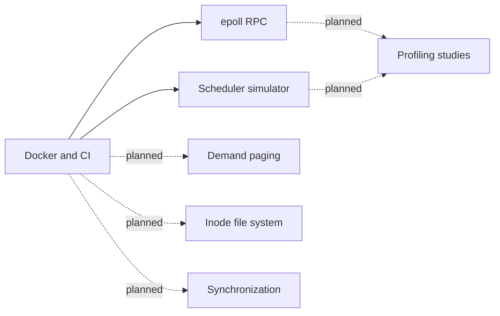

# os-subsystems

Original operating-system experiments in C++20 for Linux.

This is a personal project started in 2026. It is separate from course labs.
No course lab code is copied or adapted.

## Component map



## Status

| Component | Status | Results |
| --- | --- | --- |
| Docker and continuous integration (CI) | Local build and tests pass; GitHub CI has not run | Image and binary measurements below |
| Remote procedure call (RPC) service | Implemented and tested | Saved loopback measurements below |
| Scheduler simulator | Implemented and tested | Saved simulation results below |
| Virtual memory, file system, synchronization, profiling | Planned | Not measured |

## Measured results

Measurements were made on 2026-10-13. The host was an Apple M4 with 16 GiB RAM.
Docker Desktop used a Linux ARM64 virtual machine (VM) with 10 logical CPUs.
Benchmark containers had a 4-CPU limit and a 4 GiB memory limit. Other workloads
shared the VM. Compiler: Clang 19.1.7. Build: Release, without sanitizers.

### RPC

Each row shows the range across three runs. Each run used 500 measured requests
and 50 warmup requests per connection. The payload was 64 bytes. All connections
were open before warmup. Pipeline depth is the maximum number of outstanding
requests per connection. Latency includes time in the client's send queue.

| Connections | Pipeline depth | Measured samples, all runs | p50 (ms) | p95 (ms) | p99 (ms) | Requests/s |
| --- | --- | --- | --- | --- | --- | --- |
| 64 | 1 | 96,000 | 0.201–0.338 | 0.574–2.048 | 1.025–6.752 | 99,759–235,514 |
| 256 | 1 | 384,000 | 1.028–1.996 | 2.672–8.163 | 4.425–20.918 | 84,952–200,313 |
| 1,024 | 1 | 1,536,000 | 4.242–6.989 | 10.853–18.692 | 16.072–40.396 | 116,592–198,674 |
| 64 | 4 | 96,000 | 0.483–0.832 | 1.111–2.008 | 2.142–4.255 | 264,746–401,488 |
| 256 | 4 | 384,000 | 1.910–3.989 | 2.934–8.750 | 4.771–12.277 | 235,956–515,185 |
| 1,024 | 4 | 1,536,000 | 10.364–18.416 | 21.342–40.057 | 30.542–67.942 | 198,413–337,957 |

All 4,032,000 measured requests passed ID and payload checks. No run reported an
error. These runs do not support a median below 1 ms at 256 connections. This is
a loopback test with a closed request loop. It does not establish latency on a
remote network or under a fixed external arrival rate.

Source: [RPC results and raw samples](results/20261013T195428Z-rpc/rpc.json).
See the [environment record](results/20261013T195428Z-rpc/environment.json) and
[protocol and measurement rules](docs/rpc.md).

### Schedulers

These values use simulated time. They are not wall-clock speed measurements.
Each policy ran once on each deterministic workload. The mixed workload has
12 processes. Every process completed.

| Policy | Mean response (simulated ms) | Mean turnaround (simulated ms) | Processes with a ready wait ≥50 ms |
| --- | --- | --- | --- |
| FIFO | 253.333 | 343.667 | 11 |
| Round-robin | 7.000 | 324.667 | 0 |
| MLFQ | 3.167 | 257.583 | 0 |
| CFS | 1.583 | 210.458 | 0 |

The fairness tests use a 500 ms observation window. All processes stay runnable.
Jain's index uses CPU service divided by process weight. Its maximum is 1.

| Policy | Equal weights, 8 processes | Different nice values, 4 processes |
| --- | --- | --- |
| FIFO | 0.125000 | 0.250000 |
| Round-robin | 0.999808 | 0.483770 |
| MLFQ | 0.999041 | 0.482439 |
| CFS | 0.999936 | 0.999975 |

Source: [scheduler results, inputs, and timelines](results/20261013T221310Z-sched/scheduler.json).
See [policy rules and metric definitions](docs/schedulers.md). CFS models the
historical vruntime design. It does not reproduce the current Linux scheduler.

### Container and validation

| Check | Observed result | Evidence |
| --- | --- | --- |
| Uncompressed image layer archives, Linux ARM64 | 103,430,144 bytes (103.430 MB) | [Image record](results/m7/image.json) |
| Compressed layer blobs | 30,284,053 bytes (30.284 MB) | [Layer sizes](results/m7/image.json) |
| Local image disk use reported by Docker | 140 MB | [Image record](results/m7/image.json) |
| Two clean Release builds | Identical hashes for all four installed programs | [Build A](results/m7/binaries-a.sha256), [build B](results/m7/binaries-b.sha256) |
| Runtime image programs | Same hashes as both clean builds | [Runtime hashes](results/m7/runtime-binaries.sha256) |
| Normal, ASan, UBSan, and TSan tests | All 16 test runs passed | [Validation record](results/validation/summary.json) |

The image measurements count different data. Uncompressed archive bytes include
tar headers and padding. Local disk use includes compressed data and unpacked
files. Docker Engine 29.7.2 reports a smaller value through `image inspect` on
this store. See the [Docker size notes](docs/container-evidence.md). The binary
check does not establish identical image manifests or identical builds across
CPU architectures. GitHub CI remains unverified.

## Build and test

Prerequisites: Docker with a Linux engine, Make, and an internet connection for
the first build. Use a Linux ARM64 or AMD64 host. On macOS, use Docker Desktop.

1. Build the development image.

   ```sh
   make dev
   ```

2. Run all tests and sanitizer builds.

   ```sh
   make test
   ```

3. Build the runtime image.

   ```sh
   make image
   docker run --rm os-subsystems:local
   ```

AddressSanitizer (ASan), UndefinedBehaviorSanitizer (UBSan), and ThreadSanitizer
(TSan) use separate builds. A failed test stops the command. The test container
uses an unrestricted seccomp profile so TSan can set its address layout. The
runtime container uses Docker's default profile and a non-root user.

The base image has a fixed digest. Package sources use a dated Debian snapshot.
See [the Dockerfile](docker/Dockerfile) for these values. The runtime image holds
the installed programs and their runtime libraries. Build tools stay in the
development image.

The CI file is ready for GitHub Actions. A local test result does not show that
GitHub CI has passed.

## Repeat the measurements

Prerequisites: the build tools listed above. The image report and raw result
check also need Python 3 on the host.

1. Run the RPC measurements.

   ```sh
   HOST_LABEL='Describe your host CPU and RAM' make bench
   ```

2. Run the scheduler measurements.

   ```sh
   make sched-bench
   ```

3. Check two clean builds.

   ```sh
   make repro
   ```

4. Save the runtime image measurements.

   ```sh
   make image
   python3 scripts/image_evidence.py
   ```

5. Check the saved samples and timelines.

   ```sh
   python3 scripts/check_results.py
   ```

## Design and evidence

See the [implementation plan](docs/implementation-plan.md) for scope, measurement
rules, and references. Result files include commands, sample counts, hardware,
and source hashes. The repository includes the original measured runs.
